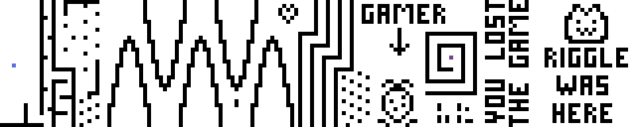

# wwwwww

Don't you love switch statements?

The challenge idea is to write a script that reads the switch statements (jumps) and reconstructs the original arena.

The game itself works much like [VVVVVV](https://store.steampowered.com/app/70300/VVVVVV/). In this our case,
there are four controls:

- reverse gravity (`w`)
- go left (`a`)
- do nothing (`s`)
- go right (`d`)

When starting the challenge, player should quickly notice how there's only 3 changing variables, all of
which can be controlled. As they are compared to predefined values on a x y coordinate grid, they can assume
we are playing some sort of game with no UI. Taking a closer look at the switch statements reveals comparisons
to player values on every move.

[`gen.py`](./source/gen.py) reads [`arena.png`](./source/arena.png) and generates a match condition for every black pixel.
This is then compiled into a large switch statement which needs to be reverse engineered. `solution/moves.txt` contains
the correct moves that need to be executed to win. The actual moves can vary, as there are multiple solutions.
To win, the player (blue pixel) must reach the end, signified by the purple pixel. Black pixels are spikes (bad).
The game ticks on every move and does not have any time components.

## Building

Run `make -C source build`

This will automatically get the latest arena, parse it and include that in the code.

## Distribution

Run `make -C source dist`

## Cleaning

I think you know by now

## Running

`make -C source build && docker run --rm -p 1337:1337 wwwwww`

## Debugging

From the challenge directory, rename or delete `solution/moves.txt` and run
`python solution/test.py`. Use `wasd` to control. When you win, the moves will
automatically be recorded in `solution/moves.txt` and `python solution/solve.py`
should return the flag as normal.
