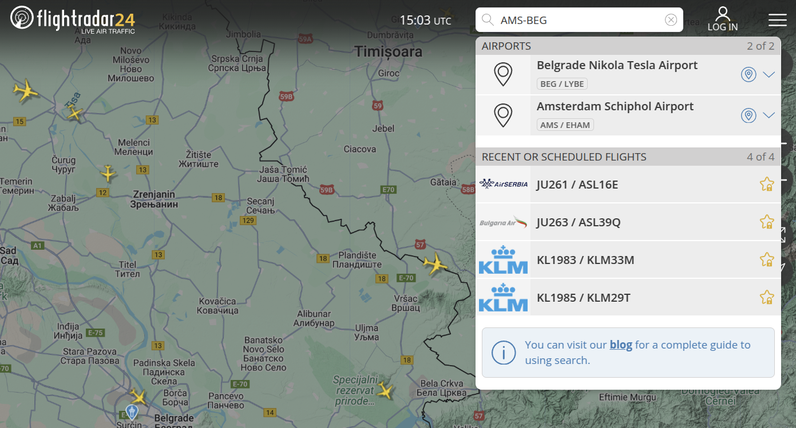
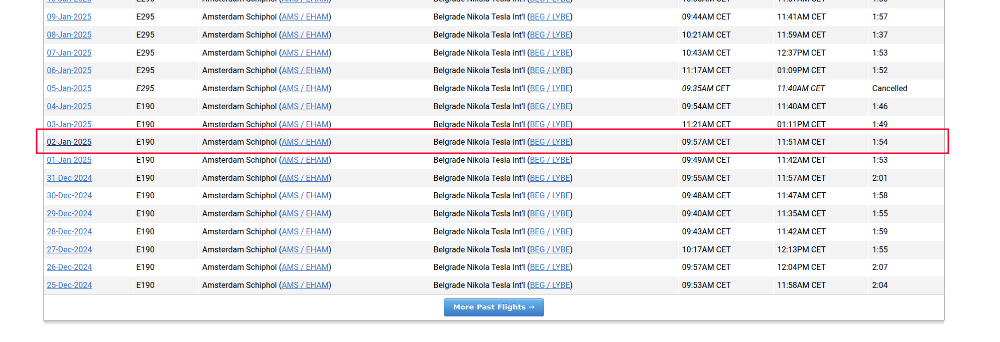
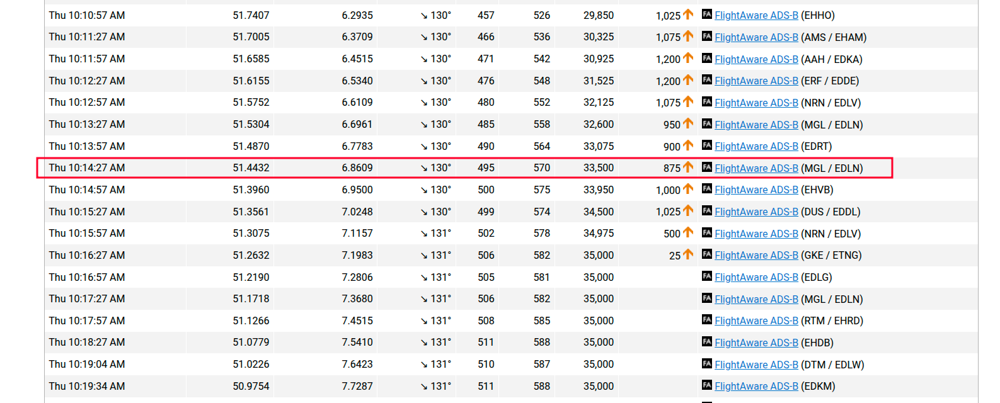

# OSINT - GrafijaGuesser 7

**Author** : Marko Gordic  
**Difficulty**: <font color='orange'>Medium</font>  
**Description**: Team Serbia's trainer took a flight in January, flying from Amsterdam Schiphol to Serbia's main airport, Nikola Tesla. CyberHero is curious about where the photo was taken. He believes there's a way to determine the exact minute the picture was captured. Can you help him find the coordinates? Enter the flag in the format SCC{XX.XX,YY.YY}.

**External resources**:

/

**Flag**: `SCC{51.44,6.86}`

# Writeup

## Solution

As described in the challenge description itself, there is a way to determine the time. The first thing that comes to mind, since this involves an image, is to check its metadata. For this, you can use exiftool. You will get a large output, but the following part is particularly interesting:

```
Exif Byte Order                 : Big-endian (Motorola, MM)
Make                            : Samsung
Resolution Unit                 : inches
Software                        : Samsung Camera
Modify Date                     : 2025:01:02 10:14:27
Y Cb Cr Positioning             : Centered
Exif Version                    : 0232
Date/Time Original              : 2025:01:02 10:14:27
Create Date                     : 2025:01:02 10:14:27
Components Configuration        : Y, Cb, Cr, -
Flashpix Version                : 0100
Owner Name                      : NZT
```

Now that we know when the image was taken, we need to figure out the location. How can we do that? The first idea is to use the FlightRadar24 application. In the upper right corner, there is a search feature. Since we know both the departure and destination airports, we can easily search for possible flights.



As you can see, we got 4 results. Looking at the image again, you can see the KLM logo on the wing of the airplane. Therefore, we can try the first of the two KLM results (this part might be a bit tricky and somewhat based on guesswork).

Since not everyone has a paid FlightRadar24 account, we can perform another search (https://www.google.com/search?q=KLM+flight+KL1983) and one of the possible results will be from the website https://www.flightaware.com/. It offers historical flight data for up to 3 months and displays all the information. Here we can open this flight and find the one that was closest in time to the image.



Now, we just need to find the exact or closest time. In that row, the coordinates of the airplane at that moment will also be displayed.


